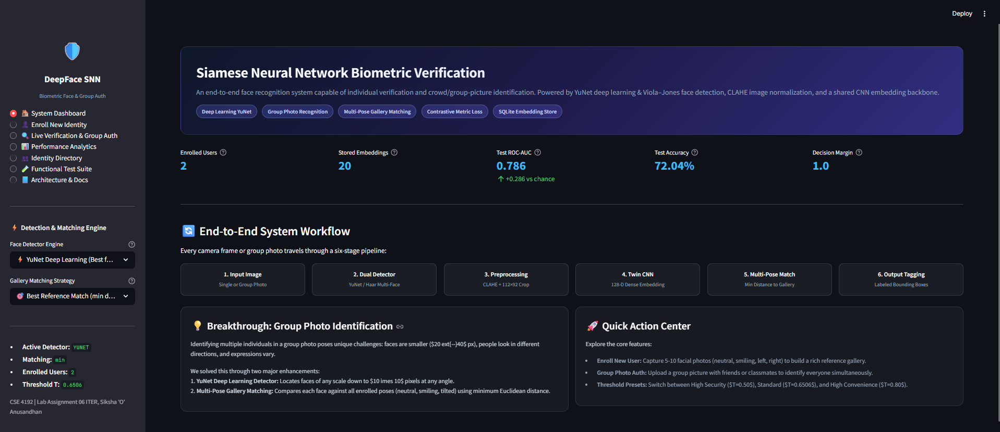
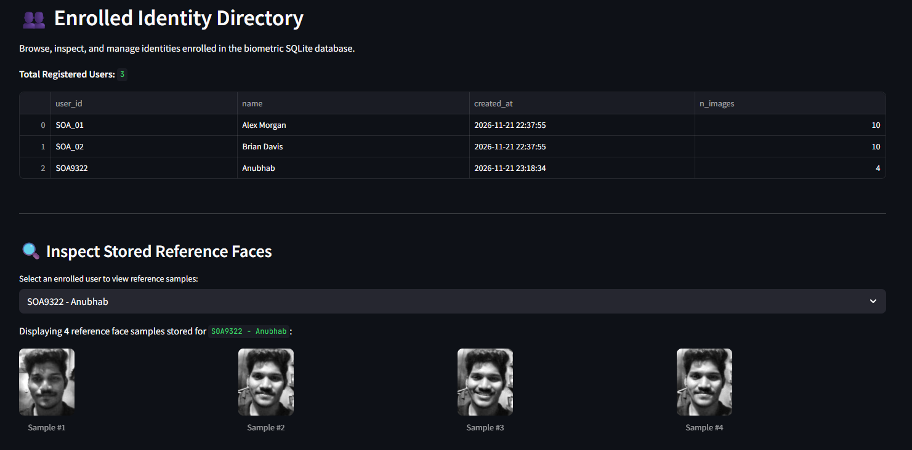
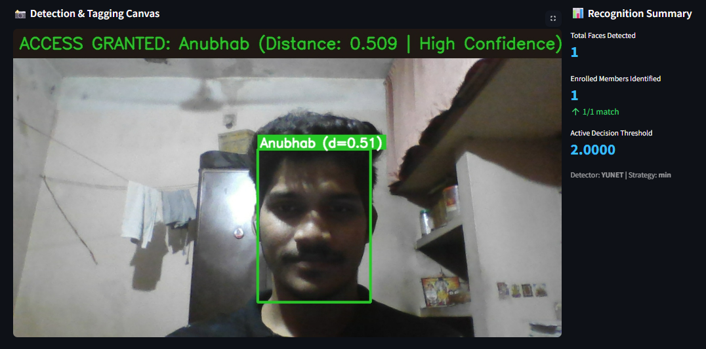
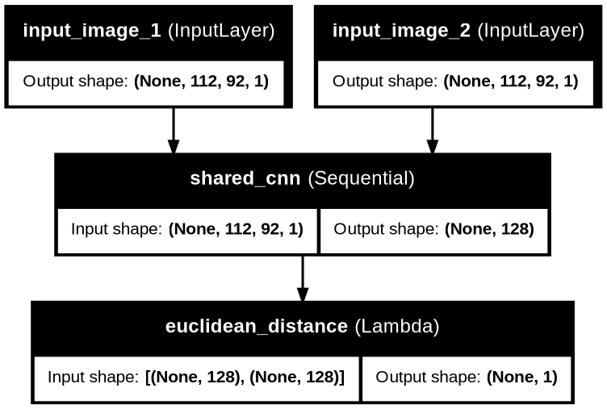
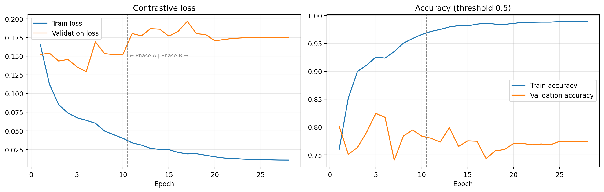
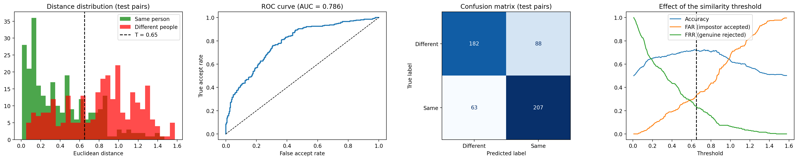
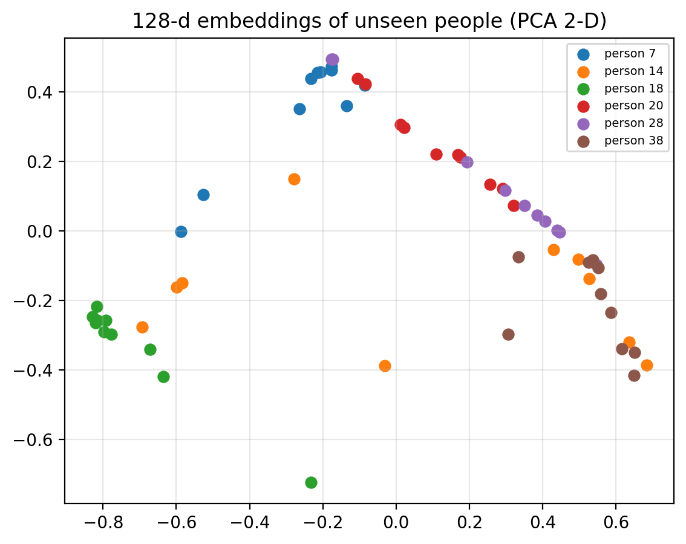
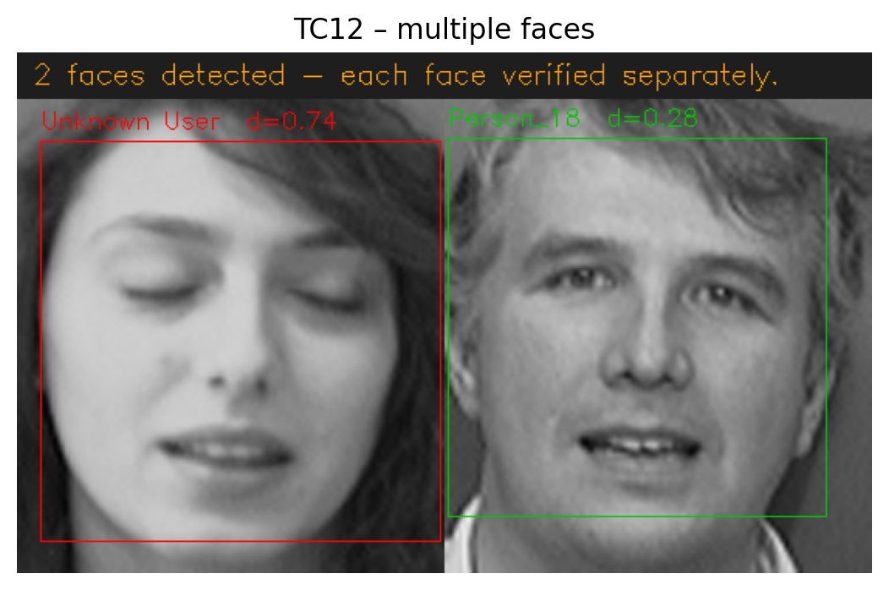
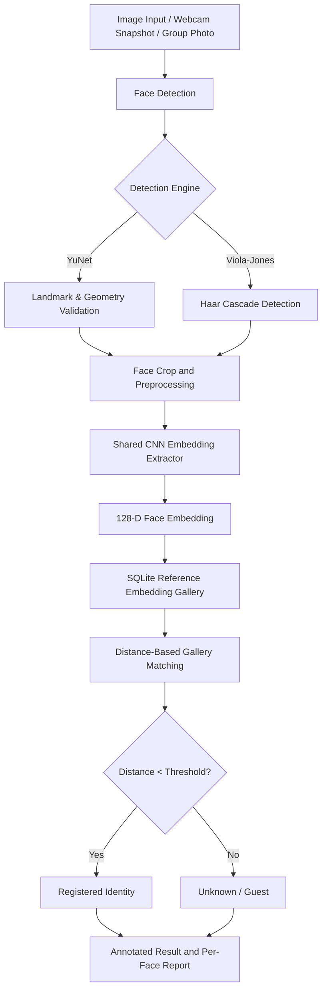
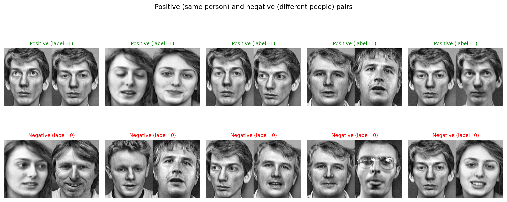

<div align="center">

# 🛡️ DeepFace SNN — Siamese Neural Network Face Recognition System

### An End-to-End Biometric Verification Platform with Multi-Face Detection, Identity Enrollment & Group Recognition

<p align="center">
  &nbsp;
  &nbsp;
  &nbsp;
  &nbsp;
  &nbsp;
  
</p>

<p align="center">
  &nbsp;
  &nbsp;
  &nbsp;
  
</p>

**DeepFace SNN** is a full-stack face recognition and biometric verification application built around a Siamese Convolutional Neural Network. It combines face detection, image normalization, shared-weight feature extraction, Euclidean-distance matching, multi-pose identity galleries, and SQLite-based embedding storage in an interactive Streamlit application.

</div>

---

## 📌 Table of Contents

- [Project Overview](#-project-overview)
- [Problem Statement](#-problem-statement)
- [Key Features](#-key-features)
- [Application Interface](#-application-interface)
- [System Architecture](#-system-architecture)
- [Recognition Pipeline](#-recognition-pipeline)
- [Siamese Neural Network](#-siamese-neural-network)
- [Face Detection & Preprocessing](#-face-detection--preprocessing)
- [Identity Enrollment & Database](#-identity-enrollment--database)
- [Dataset](#-dataset)
- [Experimental Results](#-experimental-results)
- [Functional Testing](#-functional-testing)
- [Technology Stack](#-technology-stack)
- [Repository Structure](#-repository-structure)
- [Installation](#-installation)
- [Running the Application](#-running-the-application)
- [Training the Model](#-training-the-model)
- [Command-Line Usage](#-command-line-usage)
- [Configuration](#-configuration)
- [Model Artifacts](#-model-artifacts)
- [Limitations & Future Improvements](#-limitations--future-improvements)
- [Privacy & Security Considerations](#-privacy--security-considerations)
- [Reproducibility](#-reproducibility)
- [Acknowledgements](#-acknowledgements)

---

## 🎯 Project Overview

Traditional image-classification systems generally learn a fixed set of classes. A face verification system has a different requirement: it must compare two facial observations and estimate whether they belong to the same person, including identities that were not part of the model's training identities.

This project addresses that problem through **metric learning**. A Siamese network processes two face images through the same CNN feature extractor and maps each image into a 128-dimensional embedding space. The Euclidean distance between the embeddings provides a similarity signal:

- **Smaller distance:** the two face representations are more similar.
- **Larger distance:** the two face representations are less similar.
- **Distance below the configured threshold:** the probe is treated as a match to a registered identity.
- **Distance at or above the threshold:** the probe is treated as unknown for that comparison.

The trained shared CNN is reused as an embedding extractor during enrollment and inference. The application stores multiple reference embeddings for each registered identity, allowing a probe to be compared against several facial poses rather than one template only.

### Project goals

1. Build a Siamese CNN for learning face-image similarity.
2. Train the network using balanced positive and negative image pairs.
3. Detect faces in camera frames and uploaded images.
4. Normalize detected faces to the network's expected input representation.
5. Enroll identities using multiple reference face samples.
6. Recognize registered users and reject unknown identities using a distance threshold.
7. Support multiple faces in a single image and display per-face verification details.
8. Provide a web interface for enrollment, recognition, analytics, directory management, and functional testing.

## 🧩 Problem Statement

A practical face verification workflow must handle variations in lighting, facial expression, head pose, image quality, and the number of people visible in a frame. It must also distinguish registered identities from people who have not been enrolled.

The project implements a metric-learning-based approach in which the model learns a representation space rather than a fixed identity-classification head. The system then compares probe embeddings with stored reference embeddings and applies a configurable decision threshold.

The implementation is an academic prototype based on the AT&T/ORL face dataset. Its reported test and integration results should not be interpreted as production-grade biometric performance.

## ✨ Key Features

| Feature | Implementation |
|---|---|
| Siamese metric learning | Two inputs processed by one shared CNN backbone |
| Face embeddings | 128-dimensional feature vectors |
| Similarity measurement | Euclidean distance between embeddings |
| Training objective | Contrastive loss with margin `1.0` |
| Face detection engines | YuNet and Viola–Jones Haar Cascade |
| Face preprocessing | Grayscale conversion, resizing, CLAHE and normalization |
| Multi-pose enrollment | Multiple verified face samples per identity |
| Gallery matching | Minimum distance, adaptive, and Top-3 average strategies |
| Unknown-user handling | Configurable Euclidean-distance threshold |
| Group-photo recognition | Detect and inspect multiple faces in one image |
| Persistent storage | SQLite user records and serialized embeddings |
| Reference-image storage | Per-identity image folders |
| Interactive interface | Streamlit dashboard with seven navigation pages |
| Evaluation tools | Training curves, evaluation plots, PCA and functional test report |

### Streamlit application modules

The application exposes the following pages through its sidebar:

1. **System Dashboard** — system summary, key indicators, and the end-to-end workflow.
2. **Enroll New Identity** — webcam capture or batch upload, sample validation, and identity registration.
3. **Live Verification & Group Auth** — webcam snapshot or image upload, face detection, identity matching, and per-face results.
4. **Performance Analytics** — evaluation plots, training curves, embedding visualization, and dataset statistics.
5. **Identity Directory** — enrolled-user table, reference-face inspection, and identity deletion.
6. **Functional Test Suite** — the documented TC01–TC12 test results.
7. **Architecture & Docs** — network architecture, mathematical formulation, layer configuration, and project attribution.

---

## 🖥️ Application Interface

The following screenshots show the actual Streamlit application. Keep the image files in the repository's root-level `assets/` directory and preserve the filenames shown below so GitHub can render them correctly.

### 1. System Dashboard

The dashboard presents the application overview, enrolled-user and embedding counts, model evaluation indicators, and the end-to-end recognition workflow.

<div align="center">
  
  <p><em>System Dashboard</em></p>
</div>

### 2. Identity Directory

The Identity Directory displays registered identities, enrollment metadata, stored reference-face samples, and identity-management controls.

<div align="center">
  
  <p><em>Identity Directory</em></p>
</div>

### 3. Live Verification & Group Authentication

The live verification page accepts a webcam snapshot or an uploaded portrait/group image. It displays detected faces, annotated results, the active threshold, and per-face identity-matching details.

<div align="center">
  
  <p><em>Live Verification</em></p>
</div>

### Additional project visualizations

#### Siamese network architecture

<div align="center">

  

</div>

#### Training history

<div align="center">

  

</div>

#### Evaluation plots

<div align="center">

  

</div>

#### Embedding-space visualization

<div align="center">

  

</div>

#### Multi-face detection example

<div align="center">

  

</div>

---

## 🏗️ System Architecture

The system is organized into five functional layers.



### Architectural components

| Layer | Responsibility | Main files |
|---|---|---|
| Presentation | Navigation, capture/upload controls, analytics and result display | `app.py` |
| Detection | YuNet/Haar face localization, validation, cropping and annotations | `face_detection.py` |
| Preprocessing | Grayscale conversion, resize, CLAHE and normalization | `utils.py` |
| Metric-learning model | Siamese network, shared CNN, contrastive loss and embeddings | `siamese_nn.py`, `utils.py` |
| Identity services | Enrollment, gallery consistency checks and recognition | `onboarding.py`, `face_recognition_system.py` |
| Persistence | User metadata, embeddings and reference-image files | `database.py` |

## 🔄 Recognition Pipeline

A submitted frame is processed through the following stages.

### Stage 1 — Input acquisition

The application accepts:

- A snapshot captured through Streamlit's camera input.
- A single-person portrait uploaded as JPG, JPEG, or PNG.
- A group photograph containing multiple people.

### Stage 2 — Face detection

The selected detector identifies face bounding boxes. The application supports two detection approaches:

- **YuNet:** a deep-learning face detector loaded from `models/face_detection_yunet.onnx`.
- **Viola–Jones:** OpenCV Haar Cascade frontal/profile detectors.

The YuNet path applies a confidence threshold, facial-landmark geometry checks, and non-maximum suppression. The Haar path uses histogram equalization, frontal/profile detection, and non-maximum suppression.

### Stage 3 — Face cropping and normalization

Detected face regions are cropped with contextual padding and passed through the shared preprocessing routine. The model input is a grayscale tensor with shape:

```text
(112, 92, 1)
```

The preprocessing routine resizes the crop, applies CLAHE by default, scales pixel values to `[0, 1]`, and returns a `float32` tensor.

### Stage 4 — Embedding extraction

The shared CNN maps each preprocessed face to a 128-dimensional vector:

```text
Face image: (112, 92, 1)

       ↓

Shared CNN feature extractor

       ↓

Face embedding: (128,)
```

### Stage 5 — Gallery comparison

The probe embedding is compared with the stored embeddings for each enrolled user. The application supports three gallery matching strategies:

| Strategy | Description |
|---|---|
| `min` | Selects the smallest distance to any reference sample for a user |
| `adaptive` | Combines the best reference distance with an average-distance component |
| `top_k` | Uses the average of the closest `k=3` reference distances |

The default Streamlit configuration is **Best Reference Match (`min`)**.

### Stage 6 — Decision and result rendering

The closest gallery match is compared with the active threshold. The system returns a recognized identity or an unknown/guest result and annotates the image with bounding boxes and labels. For multiple faces, each detected face is evaluated separately and shown in an individual result panel.

---

## 🧠 Siamese Neural Network

### Why a Siamese architecture?

A Siamese network contains two input branches that share the same feature-extraction weights. Instead of directly predicting an identity class, the network learns to produce embeddings in which images of the same person should be close and images of different people should be separated by a margin.

The implementation constructs one shared CNN and applies it to both image inputs:

```text
              Face Image A                 Face Image B

                   │                            │

                   ▼                            ▼

             ┌───────────┐                ┌───────────┐

             │ Shared CNN│                │ Shared CNN│

             │  Weights  │◄── shared ────►│  Weights  │

             └─────┬─────┘                └─────┬─────┘

                   │                            │

                   ▼                            ▼

             128-D Vector A                128-D Vector B

                   │                            │

                   └────────────┬───────────────┘

                                ▼

                      Euclidean Distance

                                │

                                ▼

                       Contrastive Loss
```

### Shared CNN — `lab` architecture

The saved configuration specifies `"arch": "lab"`. The corresponding shared feature extractor uses the following layers:

| Layer | Configuration | Output shape |
|---|---|---|
| Input | Grayscale face image | `(112, 92, 1)` |
| Conv2D | 64 filters, `3×3`, ReLU, valid padding | `(110, 90, 64)` |
| MaxPooling2D | Default `2×2` pooling | `(55, 45, 64)` |
| Conv2D | 64 filters, `3×3`, ReLU, valid padding | `(53, 43, 64)` |
| Flatten | Flatten feature maps | `(145856,)` |
| Dense | 128 units, sigmoid activation | `(128,)` |

The two Siamese branches call the same `shared_cnn` model, so their weights are shared rather than independently learned.

### Euclidean distance

Given two embeddings, the distance is computed as:

\[

 d(\mathbf{z}_1,\mathbf{z}_2)=

 \sqrt{\sum_{i=1}^{128}(z_{1i}-z_{2i})^2}

\]

### Contrastive loss

The implementation uses the contrastive objective with a margin of `1.0`:

\[

\mathcal{L}(y,d)=y\cdot d^2+(1-y)\cdot\max(m-d,0)^2

\]

where:

- `d` is the Euclidean distance between the two embeddings.
- `y = 1` denotes a same-person (positive) pair.
- `y = 0` denotes a different-person (negative) pair.
- `m = 1.0` is the contrastive margin.

Positive pairs are encouraged to have a small distance. Negative pairs are penalized when their distance falls inside the margin.

### Training configuration

The training script uses the following implementation defaults:

| Parameter | Value |
|---|---:|
| Optimizer | Adam |
| Initial learning rate | `0.001` |
| Contrastive margin | `1.0` |
| Batch size | `128` |
| Pair augmentation copies | `2` additional copies |
| Identity split | 28 train / 6 validation / 6 test identities |
| Random seed for identity split | `42` |
| Training script | `siamese_nn.py` |

The checked-in `outputs/training_history.csv` contains 28 recorded epochs. The exact values in that file are summarized in the results section below.

---

## 📷 Face Detection & Preprocessing

### YuNet detector

The YuNet model is loaded from:

```text
models/face_detection_yunet.onnx
```

The implementation configures a score threshold of `0.65`, a non-maximum-suppression threshold of `0.25`, and a maximum candidate count of `5000`. It also checks facial landmark geometry before accepting detections.

### Viola–Jones detector

The alternative detector uses OpenCV's Haar Cascade XML files:

- `haarcascade_frontalface_default.xml`
- `haarcascade_profileface.xml` (when available)

The grayscale frame is histogram-equalized before cascade detection. Overlapping detections are filtered using non-maximum suppression.

### Preprocessing sequence

```text
Input frame

    ↓

Face bounding box

    ↓

Context-aware crop (crop scale = 1.6)

    ↓

Grayscale image

    ↓

Resize to 92 × 112 (width × height)

    ↓

CLAHE enhancement

    ↓

Float32 normalization to [0, 1]

    ↓

Tensor shape: (112, 92, 1)
```

CLAHE is used to improve local contrast before feature extraction. The training/data utility and detector crop routine both use the common image conversion helper to produce the model's expected input shape.

---

## 👤 Identity Enrollment & Database

### Enrollment workflow

The Streamlit enrollment page supports two ways to supply reference samples:

1. **Webcam capture:** capture and add multiple face samples interactively.
2. **Batch upload:** upload multiple JPG/JPEG/PNG face images.

The registration routine:

1. Validates the supplied user ID and name.
2. Detects faces in each input frame.
3. Skips frames containing no face or multiple faces.
4. Requires at least three usable face samples by default.
5. Generates a 128-dimensional embedding for each accepted sample.
6. Performs a gallery consistency check using pairwise embedding distances and a medoid reference.
7. Stores the identity metadata and embeddings in SQLite.
8. Saves preprocessed reference crops in the identity's folder.

The Streamlit page recommends collecting five or more samples with pose/expression variation. The registration function's default minimum is three usable samples.

### SQLite schema

The database is stored at:

```text
registered_users/users.db
```

It contains two tables:

**`users`**

| Column | Description |
|---|---|
| `user_id` | Primary key for the enrolled identity |
| `name` | Display name |
| `created_at` | Registration timestamp |
| `n_images` | Number of accepted reference images |

**`embeddings`**

| Column | Description |
|---|---|
| `id` | Auto-incremented record ID |
| `user_id` | Associated identity ID |
| `embedding` | Serialized 128-dimensional `float32` vector stored as a BLOB |

The reference images are stored separately in folders named after each user ID. The application supports inspecting and permanently deleting an enrolled identity from the Identity Directory page.

---

## 🗂️ Dataset

The project uses the **AT&T Database of Faces**, commonly known as the **ORL Face Database**.

| Property | Value |
|---|---:|
| Number of identities | 40 |
| Images per identity | 10 |
| Total images | 400 |
| Original image dimensions | `92 × 112` pixels |
| Image type | Grayscale PGM |
| Model input shape | `(112, 92, 1)` |

The dataset is arranged in identity-specific folders:

```text
dataset/att_faces/

├── s1/

│   ├── 1.pgm

│   ├── 2.pgm

│   └── ...

├── s2/

│   ├── 1.pgm

│   └── ...

└── ...

    └── s40/
```

### Identity-wise data splitting

The `split_by_identity()` utility separates identities rather than randomly splitting individual images. With the checked-in defaults, the split is:

| Split | Identities | Images |
|---|---:|---:|
| Training | 28 | 280 |
| Validation | 6 | 60 |
| Testing | 6 | 60 |
| **Total** | **40** | **400** |

This design keeps the identity groups disjoint across the three partitions and evaluates whether the learned embedding can generalize to identities excluded from training.

### Pair generation

The `create_pairs()` utility creates:

- **Positive pairs:** two images belonging to the same identity (`label = 1`).
- **Negative pairs:** images belonging to different identities (`label = 0`).

The generated set is balanced by constructing an equal number of negative pairs to positive pairs. Pair augmentation can be enabled for training data and includes transformations such as rotation, scaling, translation, horizontal flipping, brightness variation, and noise.

<div align="center">

  

  <p><em>Examples of positive (same identity) and negative (different identity) training pairs.</em></p>

</div>

---

## 📊 Experimental Results

The values in this section are taken from the project's checked-in training history, configuration, dashboard code, and functional test report. Training metrics, offline pair-evaluation indicators, and end-to-end integration tests measure different things and are therefore reported separately.

### 1. Recorded training history

The file `outputs/training_history.csv` contains **28 epochs**.

| Metric | Recorded result | Epoch |
|---|---:|---:|
| Highest training accuracy | 98.96% | 27 |
| Final training accuracy | 98.96% | 28 |
| Final training loss | 0.01095 | 28 |
| Highest validation accuracy | 82.46% | 5 |
| Lowest validation loss | 0.12932 | 6 |
| Final validation accuracy | 77.43% | 28 |
| Final validation loss | 0.17547 | 28 |

**Interpretation:** training accuracy improves steadily, while validation accuracy fluctuates and ends below its early peak. The gap between training and validation behavior indicates a generalization challenge and suggests that further regularization and model-selection work may be useful.

<div align="center">

  

</div>

### 2. Dashboard evaluation indicators

The System Dashboard in `app.py` displays the following model-evaluation indicators:

| Indicator | Dashboard value |
|---|---:|
| Test ROC-AUC | 0.786 |
| Test accuracy | 72.04% |
| Reference decision threshold | 0.6506 |
| Contrastive margin | 1.0 |

The Functional Test Suite page also documents an offline false-accept rate of **32.59%** at `T = 0.6506`. These dashboard values are hard-coded display indicators in the current application source; they are not recalculated dynamically when the page loads.

### 3. Recognition configuration

The checked-in `models/config.json` contains:

```json
{

  "arch": "lab",

  "threshold": 0.6505851149559021

}
```

The default matching strategy used by the Streamlit application is `min` (best reference match). The interface allows the operator to switch between the `min`, `adaptive`, and `top_k` strategies and to adjust the active threshold.

### 4. Evaluation visualizations

The archive includes a composite evaluation figure and a PCA visualization of face embeddings.

<div align="center">

  

</div>

<div align="center">

  

</div>

---

## 🧪 Functional Testing

The project includes 12 documented integration/functional test cases in `test_cases/test_results.csv`.

<details open>

<summary><strong>Functional test summary — 11 passed, 1 failed</strong></summary>

| Test ID | Test description | Recorded result | Status |
|---|---|---|---|
| TC01 | Load face dataset | 400 images, 40 people, shape `(400, 112, 92, 1)` | ✅ Pass |
| TC02 | Generate positive pairs | 270 positive pairs; same identity verified | ✅ Pass |
| TC03 | Generate negative pairs | 270 negative pairs; different identities verified | ✅ Pass |
| TC04 | Generate feature vectors | Embedding shape `(1, 128)` | ✅ Pass |
| TC05 | Calculate Euclidean distance | Output shape `(8, 1)` | ✅ Pass |
| TC06 | Train Siamese model | 28 epochs; final recorded accuracy 98.96% | ✅ Pass |
| TC07 | Detect a face | Face found in 80% of the tested frames | ✅ Pass |
| TC08 | Register a new user | Five face samples registered in the test | ✅ Pass |
| TC09 | Recognize registered user | 13 of 15 probes recognized (87%) | ✅ Pass |
| TC10 | Reject an unknown user | 20 of 30 unknown probes rejected (67%) | ❌ Fail |
| TC11 | Handle frame with no face | `NO_FACE` response returned | ✅ Pass |
| TC12 | Handle multiple faces | Two faces detected and evaluated separately | ✅ Pass |

</details>

### Important: unknown-user rejection

TC10 is the one documented failure. The report states that 20 out of 30 unknown-person frames were correctly rejected, while 10 were mistakenly accepted. This corresponds to a 67% rejection rate in that specific integration test.

This result is important when interpreting the project: successful recognition of enrolled users does not by itself guarantee reliable rejection of unknown users. The threshold and matching strategy need to be evaluated using separate genuine and impostor distributions, with particular attention to false acceptance and false rejection.

---

## 🧰 Technology Stack

| Category | Technologies |
|---|---|
| Programming language | Python |
| Deep learning | TensorFlow, Keras |
| Computer vision | OpenCV, YuNet, Haar Cascade |
| Numerical computing | NumPy |
| Data analysis | Pandas |
| Visualization | Matplotlib, Streamlit charts/dataframes |
| Machine-learning utilities | scikit-learn |
| Database | SQLite |
| Web application | Streamlit |
| Model format | Keras H5 (`.h5`) |
| Face detector format | ONNX (`.onnx`) |

### Python dependencies

The repository's `requirements.txt` specifies:

```text
tensorflow>=2.13

opencv-python

numpy

matplotlib

scikit-learn

pandas

streamlit
```

The project was developed with a Python 3.13 environment (as indicated by the archived bytecode filename). TensorFlow/OpenCV compatibility depends on the installed platform and package versions; use a Python version supported by the TensorFlow release selected for your environment if installation fails.

---

## 📁 Repository Structure

```text
Face_Recognition_Project/

│

├── app.py                           # Main Streamlit application

├── app_backup.py                    # Earlier application backup

│

├── siamese_nn.py                    # Siamese model construction and training

├── utils.py                         # Dataset, preprocessing, pairs, loss and embeddings

├── face_detection.py                # YuNet/Haar detection, crop and annotation

├── face_detection_backup.py         # Earlier detector backup

├── face_recognition_system.py       # Identity matching and frame recognition

├── face_recognition_system_backup.py # Earlier recognition backup

├── onboarding.py                    # Identity enrollment and consistency checks

├── database.py                      # SQLite user and embedding operations

│

├── requirements.txt                 # Python dependencies

├── README.md                        # Project documentation

│

├── dataset/

│   └── att_faces/                    # AT&T / ORL face dataset (40 × 10 images)

│       ├── s1/ ... s40/

│       └── README

│

├── models/

│   ├── siamese_nn.h5                 # Trained Siamese network (\~214 MB)

│   ├── face_detection_yunet.onnx     # YuNet face detector

│   └── config.json                   # Architecture and recognition threshold

│

├── registered_users/

│   ├── users.db                      # Local SQLite database

│   └── <user_id>/                    # Stored reference face crops

│

├── outputs/

│   ├── 01_dataset_samples.png

│   ├── 02_preprocessed_samples.png

│   ├── 03_pairs.png

│   ├── 03b_augmented_pairs.png

│   ├── 04_siamese_architecture.png

│   ├── 05_contrastive_loss.png

│   ├── 06_training_curves.png

│   ├── 07_evaluation.png

│   ├── 08_embedding_pca.png

│   ├── 09_viola_jones_detection.png

│   ├── 10_webcam_detection.png

│   ├── 10b_webcam_crop.png

│   ├── 11_demo_recognition_results.png

│   ├── 12_enrolment_user1.png

│   ├── 12_enrolment_user2.png

│   ├── 13_tc12_multiple_faces.png

│   └── training_history.csv

│

├── assets/

│   ├── dashboard.png              # System Dashboard screenshot
│   ├── identity_directory.png      # Identity Directory screenshot
│   └── live_verification.png       # Live Verification screenshot

│

└── test_cases/

    └── test_results.csv              # TC01–TC12 functional test report
```

> **Note:** `app_backup.py`, `face_detection_backup.py`, and `face_recognition_system_backup.py` are retained backup files. The main application imports the non-backup modules.

---

## ⚙️ Installation

### 1. Clone the repository

```bash
git clone <YOUR_REPOSITORY_URL>

cd Face_Recognition_Project
```

Replace `<YOUR_REPOSITORY_URL>` with the URL of your GitHub repository.

### 2. Create a virtual environment

**Windows (PowerShell):**

```powershell
python -m venv .venv

.\.venv\Scripts\Activate.ps1
```

**macOS / Linux:**

```bash
python3 -m venv .venv

source .venv/bin/activate
```

### 3. Upgrade pip and install dependencies

```bash
python -m pip install --upgrade pip

pip install -r requirements.txt
```

If TensorFlow cannot be installed for the Python version in use, create the environment with a Python release supported by the TensorFlow version available for your operating system, then repeat the installation.

### 4. Verify the required model files

Confirm that these files are present:

```text
models/siamese_nn.h5

models/face_detection_yunet.onnx

models/config.json
```

The Streamlit app loads the trained Siamese model and detector from these paths. The YuNet detector and configuration file are small repository assets. The trained Siamese model (`siamese_nn.h5`) is approximately 214 MB and may be excluded from a standard GitHub repository because GitHub blocks files larger than 100 MB. If it is not present in your clone, obtain the model artifact from the project maintainers or train it using the instructions below before launching the application.

---

## 🚀 Running the Application

From the project root, activate the virtual environment and run:

```bash
streamlit run app.py
```

Streamlit will print a local URL, normally:

```text
http://localhost:8501
```

Open that address in a browser.

### Suggested application walkthrough

1. Open **System Dashboard** to inspect the system summary and workflow.
2. Open **Enroll New Identity** and provide a unique user ID and display name.
3. Capture or upload at least three usable face samples. Five or more varied samples are recommended by the interface.
4. Register the identity and confirm that the reference samples are stored.
5. Open **Identity Directory** to inspect the registered record and stored samples.
6. Open **Live Verification & Group Auth** and capture a webcam snapshot or upload a test image.
7. Inspect the annotated image, detected-face count, closest identity, distance, threshold, and per-face match result.
8. Open **Performance Analytics** and **Functional Test Suite** to inspect the saved experiment and test results.

### Camera access

The Streamlit camera input requests permission through the browser. If camera capture is unavailable, use the image-upload option. The command-line webcam scripts use OpenCV camera access and generally require a locally available camera device.

---

## 🏋️ Training the Model

The project includes a training script that loads the ORL dataset, performs an identity-wise split, creates balanced pairs, builds the Siamese network, trains it, and saves the resulting model.

Run from the repository root:

```bash
python siamese_nn.py dataset/att_faces
```

The script saves the trained network to:

```text
models/siamese_nn.h5
```

The script uses the `lab` shared-CNN architecture by default. It performs an initial training phase and then a second phase with early stopping and learning-rate reduction. Training can take time and requires enough memory for the generated image pairs.

### Training artifacts

- `models/siamese_nn.h5` — serialized Siamese model.
- `models/config.json` — selected architecture and recognition threshold.
- `outputs/training_history.csv` — recorded training and validation metrics from the archived run.
- `outputs/06_training_curves.png` — plotted training history.

The checked-in CSV is the recorded run included with this archive. Running training again may produce different results depending on package versions, hardware, random seeds, and data ordering.

---

## 🖥️ Command-Line Usage

### Face detection

```bash
python face_detection.py
```

This starts the local face-detection demonstration when run in an environment with a webcam. Press `q` to exit the OpenCV window.

### Face recognition

```bash
python face_recognition_system.py
```

This launches the local recognition demonstration. Press `q` to quit.

The command-line demonstrations use OpenCV camera capture; the Streamlit application instead uses browser-based camera snapshots or uploaded image files.

---

## 🎚️ Configuration

### Model configuration — `models/config.json`

```json
{

  "arch": "lab",

  "threshold": 0.6505851149559021

}
```

| Key | Purpose |
|---|---|
| `arch` | Shared CNN architecture selection (`lab` in the supplied model) |
| `threshold` | Default Euclidean-distance decision threshold |

### Runtime detector selection

The Streamlit sidebar exposes:

- `YuNet Deep Learning` — the preferred detector for the application, particularly for group images.
- `Viola–Jones Haar Cascade` — the classical cascade-based alternative.

### Runtime matching selection

The sidebar also exposes:

- Best Reference Match (`min distance`).
- Adaptive matching (70% best distance + 30% average distance).
- Top-3 average (`k=3`).

### Runtime threshold presets

The Live Verification page provides these presets:

| Preset | Threshold | Intended behavior |
|---|---:|---|
| High Security | `0.50` | More restrictive acceptance of matches |
| Standard Baseline | `0.6506` | Supplied baseline threshold |
| High Convenience | `0.80` | More permissive matching |

A lower threshold is stricter and may reject more unknown users, but it can also increase false rejections of genuine users. A higher threshold may improve genuine-user acceptance while increasing false acceptance. Threshold selection should be based on a held-out validation protocol appropriate to the intended application.

---

## 📦 Model Artifacts

| File | Description |
|---|---|
| `models/siamese_nn.h5` | Trained Siamese network containing the shared CNN feature extractor |
| `models/face_detection_yunet.onnx` | YuNet face detector weights |
| `models/config.json` | Architecture identifier and default distance threshold |

The Siamese model file is approximately **214 MB** in the supplied archive. The 214 MB model exceeds GitHub’s 100 MB limit for regular Git files. Keep it outside normal Git history and distribute it through Git LFS or a model-artifact hosting service. The README does not assume a download URL that has not been provided.

---

## ⚠️ Limitations & Future Improvements

The current implementation is a functional academic prototype. The included test report and validation history identify several areas that should be addressed before any real-world deployment.

### Current limitations

1. **Generalization gap:** final training accuracy is 98.96%, while final validation accuracy is 77.43%. The validation peak occurs earlier in training.
2. **Unknown-user rejection:** the documented unknown-user test rejects 20 of 30 probes (67%); 10 unknown probes are accepted incorrectly.
3. **Limited dataset scale:** the ORL dataset contains 40 identities and 400 grayscale images, which is small compared with the diversity encountered in real deployments.
4. **Threshold sensitivity:** recognition outcomes depend on the distance threshold and gallery matching strategy.
5. **Image-domain differences:** the model is trained on small grayscale face images; real camera frames may differ in resolution, lighting, pose, blur, and background.
6. **Biometric security:** the current local SQLite design is a prototype and does not implement a complete secure biometric-template lifecycle.
7. **Evaluation scope:** the supplied functional test report is useful for integration verification but is not a substitute for a large, independently collected biometric benchmark.

### Future improvements

- Expand training and evaluation data with more identities, sessions, poses, lighting conditions, and demographic diversity.
- Evaluate stronger backbones and embedding objectives while preserving identity-disjoint evaluation.
- Add systematic threshold calibration using genuine/impostor distributions and report FAR, FRR, EER, ROC-AUC, precision, recall, and confidence intervals.
- Use validation-based checkpoint selection, regularization, and stronger augmentation to reduce overfitting.
- Evaluate detector performance across face sizes, occlusions, pose angles, and crowded scenes.
- Add liveness / presentation-attack detection before treating the system as an authentication mechanism.
- Encrypt and protect biometric templates and reference images; implement access control, audit logs, retention rules, and secure deletion.
- Add automated unit/integration tests and reproducible environment locking.
- Separate model evaluation data from the identities and samples used to tune the decision threshold.

---

## 🔐 Privacy & Security Considerations

Face images and face embeddings are sensitive biometric data. The supplied archive contains a local SQLite database and enrolled reference-face images. Before publishing or sharing the repository:

- Remove personal reference images and the local `registered_users/users.db` database unless every data subject has explicitly consented to publication.
- Do not commit real user face images, biometric templates, or personal identifiers to a public repository.
- Add `registered_users/` to `.gitignore` for future development, while retaining only a clearly documented empty directory if needed.
- Restrict access to the application and database in any deployed environment.
- Implement encryption, secure backup/deletion, retention policies, and appropriate consent procedures before real-world use.
- Do not use the prototype as the sole factor for high-impact access decisions.

The model and test results in this repository do not establish resistance to spoofing, presentation attacks, demographic bias, or adversarial inputs.

---

## 🔁 Reproducibility

For a reproducible experiment, record the following alongside each training/evaluation run:

- Python, TensorFlow, Keras, OpenCV, NumPy, and scikit-learn versions.
- Dataset version and identity split assignments.
- Random seeds and pair-generation settings.
- Model architecture and checkpoint-selection rule.
- Optimizer, learning rate, batch size, epochs, and augmentation settings.
- Decision-threshold selection protocol and matching strategy.
- Evaluation metrics computed on an identity-disjoint test set.

The repository includes `outputs/training_history.csv`, `models/config.json`, and `test_cases/test_results.csv` to document the supplied run and current functional-test outcomes.

---

## 🙏 Acknowledgements

- **AT&T Laboratories Cambridge** for the ORL Database of Faces used in the project experiments.
- The TensorFlow/Keras team for the deep-learning framework.
- The OpenCV community for computer-vision utilities, Haar Cascade support, and YuNet integration.
- The Streamlit team for the interactive application framework.

### Academic project information

The application source identifies this work as a laboratory project for **CSE 4192 — Machine Learning Projects with Python**, associated with the **Institute of Technical Education and Research (ITER), Siksha 'O' Anusandhan, Bhubaneswar, Odisha**.

The source file credits the project authors as Rishav Raj, Saptorshi Kumar Paul, Anubhab Samantaray, and Suprava Pattanayak.

---

<div align="center">

### Built with Python, Deep Learning & Computer Vision

**DeepFace SNN — Learning facial similarity through Siamese metric learning.**

</div>
